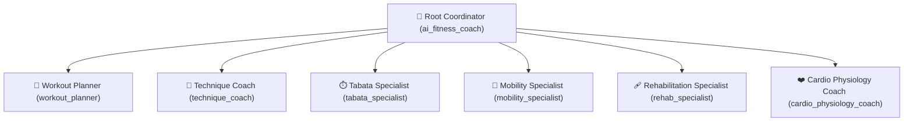

# AI Personal Fitness Coach

An intelligent, local-first personal training and clinical restoration engine tailored for home and gym workouts. Engineered with a **5-Day Rolling Split**, **6 Clinical Rehabilitation Departments**, **Dynamic Joint Mobility**, **Biomechanical Guardrails & Hard Wrist Firewall**, **25 Health Conditions across 5 Categories**, **Smartwatch Telemetry Hub with Live Web Bluetooth Sync**, and a **Google Agent Development Kit (ADK) Multi-Agent Architecture** powered by Gemini.

---

## 🌟 Highlights & System Overview

- **435 Total Exercises**:
  - **340 Strength & Hypertrophy Catalog Exercises** (including **38 Compound Combo Hybrids**).
  - **47 Dynamic Mobility Drills** across 6 anatomical kinetic checkpoints.
  - **48 Clinical Rehabilitation Drills** across 6 specialized medical departments.
- **100% Bilingual Support**: Complete Ukrainian (`UA`) and English (`EN`) localization for all 435 movements, including setup & stance cues, step-by-step execution, and pro tips.
- **Biomechanical Guardrails & Hard Wrist Firewall**: Strict zero-palm load guarantee for wrist issues, zero axial load for lumbar hernias, zero shear load for knees, and diastasis recti safe mode.
- **25 Onboarding Health Conditions across 5 Categories**: Joint isolation, female health, cardiovascular hemodynamic limits, endocrine/metabolic safety, and respiratory/gastrointestinal care.
- **Smartwatch Telemetry Hub & Live Web Bluetooth Streaming**: Live BPM streaming from Bluetooth heart rate monitors (Apple Watch, Garmin, Polar, Whoop) directly in the browser via Web Bluetooth API, plus post-workout calorie, training load, and recovery tracking.
- **5-Zone Heart Rate Physiology**: Automatic $HR_{max}$ calculation ($220 - \text{age}$ or custom lab value), target HR zone matching per workout format, and post-session coach feedback.
- **Google ADK Hierarchical Architecture**: 7 specialized agents (`workout_planner`, `technique_coach`, `tabata_specialist`, `mobility_specialist`, `rehab_specialist`, `cardio_physiology_coach`, orchestrated by `root_agent`) and 17 custom ADK tools.
- **Local-First & Private**: Powered by a local SQLite database (`data/fitness.db`) with zero external cloud dependencies for workout storage.

---

## 🏋️ Equipment & Venue Flexibility

| Venue | Equipment Supported |
| :--- | :--- |
| **🏠 Home Gym** | Adjustable dumbbells, TRX suspension trainer (Door Anchor & Pull-Up Bar Mount), mini resistance bands, long loop resistance bands, towels/sliders, small fitness ball, couch/bench support, yoga blocks, bodyweight. |
| **🏋️ Commercial Gym** | Olympic barbells, squat racks, cable crossover towers, leg press, leg extension, lying hamstring curl, lat pulldown, seated cable rows, Smith machines, adjustable benches. |

---

## 🧩 Core Architecture & Key Capabilities

### 1. 5-Day Rolling Split Architecture (~55–60 min / 10 Stations)
Every standard workout consists of **exactly 10 exercises arranged as 5 Supersets × 2 Exercises** (A1/A2, B1/B2, C1/C2, D1/D2, E1/E2) to maximize density without accumulating central nervous system fatigue:
- **Day 1: Shoulders + Biceps + Triceps + Core** (Deltoids sculpt, arm definition, wrist-safe deep core).
- **Day 2: Back + Chest + Rear Delts + Core** (Scapular posture, chest expansion, posterior chain pull).
- **Day 3: Dedicated Abs, Deep Core, Waist & Pelvic Stabilizers** (Transverse abdominis activation, zero abdominal doming, zero wrist strain).
- **Day 4: Glutes + Hamstrings + "Hip Dips / Ушки" (Gluteus Medius) + Core** (Pelvic leveling, posterior chain hypertrophy, hip stability).
- **Day 5: Quads + Inner Thighs (Adductors) + Calves & Ankle Pumps + Core** (Knee tracking, adductor tone, venous return lymphatic pumps).

### 2. Specialized Targeted Mono-Workouts
Dedicated full-session programs targeting specific goals:
- **🍑 Special 13-Exercise Lower Body & Waist Sculpt** (13 high-density exercises for glutes, adductors, and waist tightening).
- **🛡️ Pure Back & Scapular Posture** (10 exercises for thoracic extension and scapular retraction).
- **🦵 Pure Glutes & Legs Hypertrophy** (10 exercises focusing on hip thrusts, RDLs, and quad strength).
- **✨ Pure Core & Flat Stomach** (10 exercises for deep transverse abdominis and pelvic floor integration).
- **🏛️ Classic 3-Day Foundation Program** (Backward-compatible Day 1: Quads/Chest/Abs, Day 2: Hamstrings/Back/Core, Day 3: Glutes/Shoulders/Core).

### 3. ❤️‍🩹 Clinical Rehabilitation & Restoration (6 Dedicated Departments — 48 Drills)
Vetted restorative movements (8 drills per department, 2 sets × 10–12 reps or 40–50s active holds) designed for injury rehabilitation, postpartum recovery, and posture correction:

1. **🌸 Pelvic Floor & Diastasis Recti Recovery (`pelvic_floor_diastasis`)**:
   - Transverse abdominis activation, pelvic floor reconnection, and safe intra-abdominal pressure regulation (strictly no crunches, sit-ups, or abdominal doming).
2. **🦴 Hyperlordosis Correction & Lumbar Decompression (`lower_back_lordosis`)**:
   - Lumbar decompression, posterior pelvic tilt patterning, glute bridge reinforcement, and psoas release without axial spinal compression.
3. **🤲 Wrist & Carpal Tunnel Unloading (`wrists_elbows`)**:
   - Strict zero-palm bodyweight bearing: median and ulnar nerve flossing, wrist extensor gliding, and forearm myofascial decompression.
4. **🦵 Knee Joint & Hip Alignment (`knees_hips`)**:
   - Patellofemoral tracking correction: Vastus Medialis Oblique (VMO) activation, gluteus medius pelvic leveling, and safe terminal knee extension.
5. **🦶 Ankle Stability, Flat Feet & Anti-Edema Lymphatic Pump (`ankles_feet`)**:
   - Short foot arch strengthening, ankle joint distraction, and calf muscle venous pumps for lymphatic return and reducing heavy legs.
6. **🛡️ Cervical Spine & Scapular Stabilization (`neck_scapula`)**:
   - Deep neck flexor activation (chin tucks), thoracic extension, lower trapezius, and serratus anterior patterning for forward-head posture correction.

### 4. 🧘 Dynamic Joint Mobility (47 Drills across 6 Anatomical Zones)
- **General Full-Body Flow**: Balanced 10-drill sequence targeting hips (2), spine (2), shoulders (2), ankles (2), wrists/neck (1), and hamstrings (1).
- **Targeted Joint Routines**: Focus on specific anatomical zones:
  - 🦵 **Hips & Pelvis**
  - 🛡️ **Thoracic Spine & Back**
  - 💪 **Shoulders & Scapulae**
  - 🦶 **Ankles & Calves**
  - ✋ **Wrists, Forearms & Neck**
  - 🏃 **Hamstrings & Posterior Chain**
- Prescribed in **Zone 1 (50%–60% $HR_{max}$)** for active joint restoration and parasympathetic cooldown.

### 5. 🛡️ Biomechanical Guardrails & 25 Medical Conditions Matrix
The engine features a strict **Hard Firewall** that excludes forbidden movements and never falls back to unsafe exercises.

#### Category A: Joint, Spine & Biomechanical Isolation (12 Conditions)
- ✋ **Wrist (Hard Firewall / Zero-Palm)**: Eliminates push-ups, burpees, planks, bear crawls, and mountain climbers unless modified to forearms.
- 🦵 **Knee (Zero Shear)**: Excludes jump squats, sissy squats, pistol squats, and forward walking lunges.
- 🚫 **No Kneeling (No All-Fours)**: Excludes quadruped postures and exercises with direct knee contact on the floor.
- 🦴 **Lower Back / Hernia (Zero Axial)**: Excludes heavy barbell back squats, good mornings, and bent-over barbell rows.
- 📐 **Hyperlordosis (Anterior Pelvic Tilt)**: Excludes hyperextensions and hip-flexor-dominant straight leg raises.
- 💪 **Shoulder Impingement**: Excludes upright rows, behind-the-neck presses, and deep dips.
- ⚡ **Elbow Tendonitis / Epicondylitis**: Excludes heavy skull crushers and close-grip tricep presses.
- 🦶 **Ankle Sprain / Mobility**: Excludes plyometric jumping, burpees, and high-impact dorsiflexion.
- 🦴 **Hip Impingement / Labrum**: Excludes extreme hip flexion angles and jump lunges.
- 🧘 **Neck / Cervical Spine Tension**: Excludes neck sit-ups and heavy barbell shrugs.
- ⚡ **Sciatica / Piriformis Syndrome**: Excludes aggressive sciatic nerve tensioning and heavy seated leg presses.
- 🦶 **Flat Feet / Plantar Fasciitis**: Replaces explosive foot strikes with controlled intrinsic foot activation.

#### Category B: Female Health & Posture (4 Conditions)
- 🌸 **Diastasis & Pelvic Floor Safe**: Bans crunches, sit-ups, V-ups, and prone doming planks.
- 🤰 **Pregnancy Safe Protocol**: Eliminates supine inferior vena cava compression, prone positions, and high intra-abdominal pressure.
- 👶 **Postpartum Recovery**: Gentle core restoration without axial loading or plyometrics.
- 🩸 **Varicose Veins (Anti-Stagnation)**: Excludes prolonged static standing holds and wall sits; promotes calf muscle pumping.

#### Category C: Cardiovascular & Hemodynamic (3 Conditions)
- 🫀 **Hypertension**: Eliminates head-below-heart inversions (pike push-ups, decline planks) and Valsalva breath-holding.
- 📉 **Hypotension**: Prevents rapid orthostatic level shifts between floor and standing.
- 💓 **Arrhythmia / Tachycardia**: Caps cardiovascular intensity to Zone 1–2 (recovery/aerobic base).

#### Category D: Endocrine, Metabolic & Recovery (4 Conditions)
- 🦋 **Thyroid / Hypothyroidism (Anti-Cortisol)**: Replaces exhaustive HIIT with controlled tempo and extended rest periods (75s+) to prevent cortisol spikes.
- 🔋 **Adrenal Fatigue**: Enforces 90s+ rest between sets and moderate pacing.
- 🩺 **Type 2 Diabetes (Insulin Sensitivity)**: Prioritizes large muscle group recruitment (quads, glutes, lats) to stimulate GLUT4 glucose uptake.
- 💧 **Edema / Lymphatic Drainage**: Integrates venous return calf pumps and eliminates blood pooling.

#### Category E: Respiratory & Gastrointestinal (2 Conditions)
- 🫁 **Asthma Care**: Regulates cadence and excludes breathless sprint intervals.
- 🔥 **GERD / Acid Reflux**: Eliminates inverted torso positions, decline presses, and flat supine crunches.

---

## ⏱️ Workout Execution Formats & Protocols

1. **📋 Standard Sets & Superset Pairs**:
   - 5 superset pairs (A1/A2, B1/B2, C1/C2, D1/D2, E1/E2) with 45–90s recovery.
2. **🔁 Circuit Training**:
   - 10 exercises performed in continuous sequence with 15s transition between stations; 2–3 rounds.
3. **⏱️ Interactive Tabata Protocol & Voice Engine**:
   - 40 seconds of high-intensity work / 10 seconds of rest, 8 cycles per set, 60s recovery between sets.
   - **Rising dynamic countdown tone** and visual pulsing heartbeat in the final 10 seconds.
   - **Web Speech API voice callouts** speaking upcoming movements during rest intervals.
4. **🥪 "Sandwich" Pyramid Ladder**:
   - 10-station pyramid: `Ex 1 -> 1+2 -> 1+2+3 ... up to 1..10! Then descend: 2..10 -> 3..10 ... to Ex 10 alone.`

---

## ⌚ Smartwatch Telemetry Hub & 5-Zone Physiology

### Live Web Bluetooth Streaming
Connect any standard Bluetooth Heart Rate monitor (Apple Watch via compatible broadcaster, Garmin, Polar H10/OH1, Whoop, Scosche) directly in Google Chrome, Microsoft Edge, or Opera using the native **Web Bluetooth API** (`heart_rate` service, `heart_rate_measurement` characteristic). Live BPM is displayed dynamically in the top bar.

### 5 Physiological Training Zones
Calibrated automatically to user age ($HR_{max} = 220 - \text{age}$) or optional measured maximum HR:
- **Zone 1 (50%–60% $HR_{max}$)**: Active Recovery & Joint Restoration (Mobility & Rehab routines).
- **Zone 2 (60%–70% $HR_{max}$)**: Maximum Lipid Oxidation / Aerobic Base ("Fat Burning" pacing).
- **Zone 3 (70%–80% $HR_{max}$)**: Aerobic Power & Conditioning (Circuits & Toning).
- **Zone 4 (80%–90% $HR_{max}$)**: Anaerobic Threshold / Hypertrophic Mechanical Tension (Strength & Muscle Gain).
- **Zone 5 (90%–100% $HR_{max}$)**: Peak Neuromuscular Power & VO2 Max Bursts (Tabata intervals).

### Post-Workout Telemetry Hub Inputs
Upon finishing a workout, log your session data or save streamed metrics:
- **Duration** (minutes)
- **Min, Average, and Peak Heart Rate** (BPM)
- **Active Calories & Total Calories** (kcal)
- **Watch Training Load** (1.0–5.0)
- **Recovery Time** (hours)
- **Zone Minutes Breakdown** (Zone 1 to Zone 5 distribution)
- **Bilingual Physiological Analysis**: Instant coach evaluation comparing achieved HR zone vs target zone with a visual 5-zone gauge.

---

## 🤖 Google ADK (Agent Development Kit) Architecture

The coach is engineered with Google's **Agent Development Kit (ADK)** framework (`agent.py`) using Gemini models (`gemini-2.0-flash`), featuring hierarchical multi-agent delegation and custom tool calling:



### 1. Hierarchical Multi-Agent Structure
- **👑 Root Coordinator (`root_agent` / `ai_fitness_coach`)**: Orchestrates program planning, biomechanics, interval timers, clinical recovery, cardiovascular physiology, and progress tracking.
- **📅 Workout Planner Sub-Agent (`workout_planner`)**: Programs 5-Day rolling splits, targeted mono-workouts, 3-day foundation plans, and custom focus sessions.
- **🧘 Technique & Biomechanics Sub-Agent (`technique_coach`)**: Provides setup, execution steps, and joint-safe modifications across 340 strength exercises in English and Ukrainian.
- **⏱️ Tabata Interval Specialist Sub-Agent (`tabata_specialist`)**: Configures 40s/10s Tabata protocols with pacing and voice cues.
- **🤸 Mobility & Joint Restoration Sub-Agent (`mobility_specialist`)**: Builds 10-drill joint mobility flows across 6 anatomical zones.
- **🩹 Rehabilitation & Clinical Recovery Sub-Agent (`rehab_specialist`)**: Prescribes restorative routines across 6 clinical departments (diastasis, hyperlordosis, carpal tunnel, knees, ankles, cervical spine).
- **❤️ Cardio Physiology Coach Sub-Agent (`cardio_physiology_coach`)**: Calculates 5 physiological HR zones, assigns target zones, and analyzes post-workout telemetry.

### 2. Custom ADK Tools (17 Tools)
1. `generate_weekly_plan`: Generates the classic 3-day foundation weekly program with HR metadata.
2. `generate_rolling_workout`: Generates the current day of the 5-Day Rolling Split with superset structure.
3. `advance_rolling_split`: Advances the user's rolling split index to the next scheduled day.
4. `generate_mono_workout`: Generates specialized mono-workouts (13-Exercise Lower Body, Back/Posture, Glutes, Core).
5. `get_rehab_departments`: Retrieves the 6 rehabilitation departments and clinical descriptions.
6. `generate_rehab_routine`: Generates an 8-drill clinical rehabilitation routine for a chosen department.
7. `build_custom_focus_workout`: Tailors a 10-exercise session targeting user-requested muscle focus zones.
8. `generate_mobility_routine`: Builds a 10-drill joint mobility flow with Zone 1 active recovery HR metadata.
9. `get_mobility_zones`: Retrieves available anatomical mobility zones and descriptions.
10. `search_exercise_catalog`: Searches the 340-exercise library with filters for equipment, movement pattern, and joint safety.
11. `get_exercise_technique`: Biomechanical breakdown (Setup, Execution, Pro Tips) for any exercise in EN/UA.
12. `get_tabata_protocol_settings`: Protocol configuration and countdown cues for 40s/10s Tabata.
13. `calculate_heart_rate_zones`: Calculates 5 heart rate training zones and exact BPM ranges based on age and max HR.
14. `get_target_heart_rate_zone`: Prescribes optimal target HR zone and BPM bounds for specific workout formats.
15. `analyze_workout_heart_rate`: Compares recorded average & peak BPM against target zones with bilingual feedback.
16. `log_workout_progress`: Logs completed sessions, updates exercise performance, and stores smartwatch telemetry.
17. `get_user_progress_metrics`: Retrieves lifetime stats, workout counts, and weight delta tracking.

---

## 🚀 How to Run the App

### 1. Web Application (Recommended)

1. Open **Terminal** on your Mac.
2. Navigate to the project directory:
   ```bash
   cd "/Users/admin/AI Fitness Coach"
   ```
3. Start the application:
   ```bash
   python3 app.py
   ```
4. Open your web browser at:
   ```text
   http://localhost:8000
   ```
   *(If port 8000 is occupied, the server automatically selects port 8080, 8081, etc., as displayed in terminal output)*.

### 2. Standalone Interactive Console Runner
Test workouts, mobility routines, rehab flows, and telemetry calculations directly in your terminal:
```bash
python3 agent.py
```
*(Provides an interactive terminal menu `[1-7, q]` to execute ADK tools directly)*.

### 3. Google ADK CLI (Agent Explorer & Inspector)
Inspect agent reasoning, sub-agent delegation, and tool calls using Google's ADK visual explorer:
```bash
pip install google-adk
adk web
```

---

## 🗂️ Project Directory Structure

```text
AI Fitness Coach/
├── app.py                # Single-page web application server, REST API, Web Bluetooth sync, UI
├── engine.py             # Exercise rotation engine, 5-day rolling split, hard biomechanical firewall
├── models.py             # Dataclasses (Exercise, PlannedExercise, WorkoutPlan, CompletedWorkoutLog)
├── database.py           # SQLite local database layer (user profile, history, exercise catalog)
├── seed_data.py          # 340 Strength & Hypertrophy exercises + 38 Compound Combo Hybrids
├── mobility_data.py      # 47 Dynamic Mobility exercises across 6 anatomical zones
├── rehab_data.py         # 48 Clinical Rehabilitation exercises across 6 specialized departments
├── heart_rate.py         # 5-Zone heart rate modeling, target zone prescription, telemetry analysis
├── translations.py       # English & Ukrainian translation mappings, setups, and pro tips
├── agent.py              # Google ADK agent definition, 7 sub-agents, 17 custom tools, CLI runner
├── data/
│   └── fitness.db        # Local SQLite database (persists profiles, history, and metrics)
└── README.md             # System documentation and architecture reference
```

---

## 🔒 Privacy & Local Data Storage

All user settings, medical conditions, workout history, and cardiovascular telemetry are stored locally in `data/fitness.db` using SQLite. **No personal health data or biometric telemetry is sent to any third-party cloud service.**
